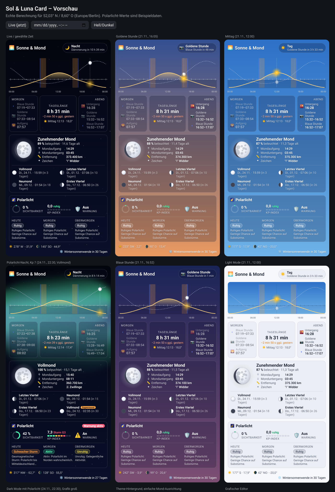
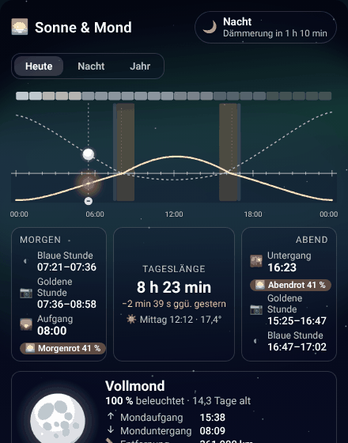

# 🌗 Sol & Luna Card

[🇬🇧 English](README.md) · **🇩🇪 Deutsch**

Eine Home-Assistant-Karte für **Sonne, Mond und Himmel**: Tagesbahn von Sonne und Mond, realistische Mondphase, goldene und blaue Stunde, Tageslänge, Jahreszeiten und **Polarlicht** – mit einem Hintergrund, der sich mit dem echten Himmel verändert.



## Funktionen

**Heute**
- **Dynamischer Himmel**: Der Hintergrund folgt der Sonnenhöhe und zeigt nachts Sterne, Sternschnuppen und bei Aktivität animiertes Nordlicht.
- **Himmelsbahn-Grafik**: Sonnen- und Mondbahn, goldene/blaue Stunde als Bänder, **Wolkenstreifen** pro Stunde und die **Gelände-Silhouette**.
- **Zeitregler**: Mit dem Finger über die Grafik ziehen zeigt Himmel, Sonne, Mond und alle Werte für diese Uhrzeit; „Jetzt ↺“ springt zurück.
- **Sonnenzeiten**: blaue/goldene Stunde, Auf- und Untergang, auch **über dem echten Horizont**, Tageslänge mit Vergleich zu gestern.
- **Abendrot- und Morgenrot-Chance** aus hohen, mittleren und tiefen Wolken.
- **Mond**: Phase so gedreht wie am Himmel, Beleuchtung, Alter, Auf-/Untergang, Entfernung, Tierkreiszeichen, nächste Phasen mit Super-/Minimond.
- **Polarlicht**: Sichtbarkeit, Kp-Index, Warnung, 3-Tage-Vorhersage und Ampel „Himmel heute Nacht“, aus HA-Entitäten oder direkt von NOAA.

**Nacht**
- **Sternenkarte** mit hellen Sternen, Sternbildern (Großer Wagen, Kassiopeia, Orion, Sommerdreieck), Planeten und Mond, per Schieberegler durch die Nacht.
- **Himmel heute Nacht**: Bewölkung Stunde für Stunde.
- **Astro-Fenster**: astronomische Nacht und mondfreie Dunkelheit.
- **Planeten** (Merkur bis Saturn): wann sichtbar, beste Zeit, Richtung, Helligkeit, Abend-/Morgenstern.
- **Sternschnuppen**: nächste Meteorströme mit Höhepunkt, Rate und Hinweis, ob der Mond stört.
- **Finsternisse**: Sonnen- und Mondfinsternisse der nächsten Jahre, **für deinen Standort berechnet** (Bedeckung, Zeiten, Sichtbarkeit).

**3D**
- **Himmelskuppel & Haus**: dein Haus (Satteldach, Größe, Ausrichtung und PV-Module einstellbar) unter einer Halbkugel mit Sonne, Mond, sichtbaren Planeten und hellen Sternen, mit Schattenwurf und den Sonnenbahnen für heute, Sommer und Winter. Ziehen zum Drehen, Regler für die Uhrzeit.

**Jahr**
- **Tageslänge im Jahresverlauf** mit Markierung für heute.
- **Sonnenbahn-Diagramm** (Sommer, Tagundnachtgleiche, Winter, heute) mit Geländeprofil.
- **Termine & Rekorde**: Jahreszeiten, längster/kürzester Tag, frühester/spätester Auf- und Untergang.

**Allgemein**
- Vier Hintergründe (Himmel, Hell, Dunkel, Theme), **Kompakt-Layout** als kleine Kachel
- **7 Sprachen**: Deutsch, Englisch, Niederländisch, Französisch, Schwedisch, Norwegisch, Dänisch
- **Grafischer Editor** für alle Optionen; alle Berechnungen laufen lokal im Browser



**[▶ Live-Demo ausprobieren](https://muhkuh666.github.io/Sol-Luna-Card/)**

## Installation

### HACS (benutzerdefiniertes Repository)

1. HACS → ⋮ → **Benutzerdefinierte Repositories**
2. URL `https://github.com/muhkuh666/sol-luna-card`, Typ **Dashboard** hinzufügen
3. „Sol & Luna Card“ installieren und den Browser-Cache leeren

### Manuell

1. `dist/sol-luna-card.js` nach `/config/www/` kopieren
2. Einstellungen → Dashboards → ⋮ → Ressourcen → `/local/sol-luna-card.js` als **JavaScript-Modul** hinzufügen

## Konfiguration

Minimal:

```yaml
type: custom:sol-luna-card
```

Standort und Zeitzone kommen automatisch aus Home Assistant.

Vollständiges Beispiel:

```yaml
type: custom:sol-luna-card
title: Sonne & Mond
layout: full               # full | compact
default_tab: today         # today | night | year
background: sky            # sky | light | dark | theme
graph_size: normal         # small | normal | large
cloud_source: auto         # auto | internet | weather | off
horizon_source: manual     # off | entity | manual
horizon_profile: "0:3, 90:2.5, 180:6, 270:2"
aurora_source: auto        # auto | entities | internet
language: auto
```

### Alle Optionen

| Option | Standard | Beschreibung |
|---|---|---|
| `title`, `icon` | „Sonne & Mond“, `mdi:weather-sunset` | Titel und Icon |
| `layout` | `full` | `full` oder `compact` (kleine Kachel) |
| `show_tabs`, `default_tab` | `true`, `today` | Tabs anzeigen, Start-Tab `today` / `night` / `year` |
| `show_night_tab`, `show_year_tab` | `true` | Tabs ein-/ausblenden |
| `scrub` | `true` | Zeitregler in der Grafik |
| `show_header`, `show_status` | `true` | Kopfzeile, Status mit Countdown |
| `show_graph`, `graph_size`, `graph_sky` | `true`, `normal`, `true` | Grafik, Größe `small`/`normal`/`large`, Himmelsverlauf in der Grafik |
| `show_moon_in_graph`, `show_hour_bands`, `show_rise_lines` | `true` | Mondbahn, goldene/blaue Stunde, Auf-/Untergangslinien |
| `show_sun_times`, `show_moon`, `show_next_phases` | `true` | Sonnenzeiten, Mond, nächste Phasen |
| `show_position`, `show_season` | `true` | Azimut/Höhe, nächste Sonnenwende |
| `show_clouds`, `cloud_source`, `weather_entity` | `true`, `auto`, – | Wolken: `auto` / `internet` (Open-Meteo) / `weather` (HA-Wetter) / `off` |
| `show_glow`, `cloud_update_minutes` | `true`, `30` | Abendrot-Chance, Abruf-Intervall |
| `horizon_source` | `off` | Echter Horizont: `off` / `entity` / `manual` |
| `horizon_entity`, `horizon_profile` | – | Entität mit Attribut `horizon` oder Profil `"0:2, 90:4, 180:1, 270:6"` (Azimut:Höhe) |
| `show_sky_map`, `show_sky_tonight`, `show_astro_window` | `true` | Nacht-Tab: Sternenkarte, Wolken, Astro-Fenster |
| `show_planets`, `show_meteors`, `show_eclipses`, `eclipse_years` | `true`, `3` | Planeten, Sternschnuppen, Finsternisse (Jahre voraus) |
| `show_year_curve`, `show_sun_path`, `show_year_dates` | `true` | Jahr-Tab |
| `show_3d_tab`, `show_house`, `show_pv`, `auto_rotate_3d` | `true`, `true`, `true`, `false` | 3D-Tab |
| `house_source`, `building_entity` | `generic`, – | `generic` = Haus aus den Maßen unten, `entity` = Gebäudemodell aus einer Entität mit Attribut `faces` (Liste aus `{t: 'r'|'w', p: [[x, y, z], …]}` in Metern) |
| `pv_flat_roofs` | `false` | PV-Module auch auf Flachdächern zeichnen (echtes Modell) |
| `roof_azimuth`, `roof_pitch` | `180`, `35` | Richtung der Hauptdachfläche (°), Dachneigung (°) |
| `house_width`, `house_length`, `wall_height` | `10`, `12`, `6` | Hausmaße in Metern (Breite quer zum First) |
| `wall_color`, `roof_color`, `pv_color` | – | Farben des Hauses |
| `show_aurora`, `aurora_effect`, `aurora_source` | `true`, `true`, `auto` | Polarlicht (siehe unten) |
| `background` | `sky` | `sky`, `light`, `dark`, `theme` |
| `moon_orientation` | `sky` | `sky` = wie am Himmel gedreht, `simple` = links/rechts |
| `stars`, `animations` | `true` | Sterne, Animationen |
| `language` | `auto` | `auto`, `de`, `en`, `nl`, `fr`, `sv`, `nb`, `da` |
| `time_format`, `refresh_period` | `auto`, `60` | 12/24 h, Aktualisierung in Sekunden |
| `*_color` | – | `sun_color`, `moon_color`, `golden_color`, `blue_color`, `curve_color`, `moon_curve_color`, `aurora_color` |
| `latitude`, `longitude`, `time_zone` | aus HA | Standort überschreiben |

### Wolken & Abendrot

Ohne weitere Einstellung lädt die Karte die Bewölkung in drei Schichten von [Open-Meteo](https://open-meteo.com). Die **Abendrot-Chance** ist am höchsten bei mittleren/hohen Wolken (etwa 30–70 %) und wenig tiefen Wolken. Alternativ kann eine Home-Assistant-Wetter-Entität (`weather_entity`) genutzt werden; dann gibt es nur die Gesamtbewölkung.

### Echter Horizont

Das Geländeprofil trägst du von Hand ein (`horizon_source: manual`, z. B. `"0:3, 90:2.5, 180:6, 270:2"` als Azimut:Höhe in Grad) oder nimmst es aus einer Entität mit Attribut `horizon` (`horizon_source: entity`). Dein Profil kannst du zum Beispiel im kostenlosen Werkzeug [PVGIS](https://re.jrc.ec.europa.eu/pvg_tools/) ablesen („Horizon profile“).

### Polarlicht-Daten

Mit `aurora_source` legst du fest, woher die Daten kommen:

| Wert | Verhalten |
|---|---|
| `auto` (Standard) | Polarlicht-Entitäten verwenden, falls vorhanden – sonst direkt aus dem Internet |
| `entities` | Nur Home-Assistant-Entitäten |
| `internet` | Immer direkt von NOAA SWPC laden |

**Internet (NOAA SWPC)** – die Karte lädt im Browser:

- [`noaa-planetary-k-index-forecast.json`](https://services.swpc.noaa.gov/products/noaa-planetary-k-index-forecast.json) – aktueller Kp-Index und Kp-Vorhersage für 3 Tage (altes und neues NOAA-Format werden unterstützt)
- [`ovation_aurora_latest.json`](https://services.swpc.noaa.gov/json/ovation_aurora_latest.json) – OVATION-Modell, daraus die Polarlicht-Wahrscheinlichkeit an deinem Standort (~0,9 MB, abschaltbar mit `aurora_ovation: false`)

Die Aktivitätsstufen folgen dem NOAA-Aurora-Dashboard: Kp 3 ruhig, Kp 5 mäßig, Kp 7 aktiv, Kp 9 sehr aktiv, dazu die NOAA-G-Skala (G1–G5). Die Tagesvorhersage nutzt den höchsten erwarteten Kp-Wert des Tages. Ob Polarlicht bei dir möglich ist, schätzt die Karte mit einer Faustregel für Europa (benötigter Kp ≈ (66 − Breitengrad) / 2, z. B. Kp 7 bei 52° N). Die Warnung wird aktiv, wenn die Sichtbarkeit `aurora_threshold` (Standard 50 %) erreicht oder der aktuelle Kp diesen Wert erreicht. Die Daten werden alle `aurora_update_minutes` (Standard 15) neu geladen und von allen Karten im Dashboard gemeinsam genutzt.

```yaml
aurora_source: internet
aurora_ovation: true
aurora_threshold: 50
aurora_update_minutes: 15
```

### Polarlicht-Entitäten

Ohne Angabe sucht die Karte automatisch nach Entitäten mit „aurora“ (Sichtbarkeit in %, Warnung als `binary_sensor`, Vorhersagen für heute/morgen/übermorgen) und nach einem Kp-Index-Sensor („k_index“ / „kp_index“). Wenn etwas nicht erkannt wird, trägst du die Entitäten im Editor unter **Polarlicht** ein:

```yaml
aurora_visibility_entity: sensor.aurora_visibility_visibility
aurora_alert_entity: binary_sensor.aurora_visibility_visibility_alert
aurora_kp_entity: sensor.planetary_k_index
aurora_activity_entity: sensor.aurora_activity_level
aurora_today_entity: sensor.aurora_heute
aurora_today_text_entity: sensor.aurora_forecast_heute
aurora_tomorrow_entity: sensor.aurora_morgen
aurora_tomorrow_text_entity: sensor.aurora_forecast_morgen
aurora_day_after_entity: sensor.aurora_ubermorgen
aurora_day_after_text_entity: sensor.aurora_forecast_ubermorgen
```

Ein Klick auf einen Polarlicht-Wert öffnet die Detailansicht der Entität.

## Genauigkeit

Sonne und Mond werden nach Meeus berechnet, die Planeten mit den Bahnelementen des JPL. Sonnenzeiten und Mondphasen liegen innerhalb weniger Minuten der veröffentlichten Werte. Beispiel Sonnenfinsternis 12.08.2026 in Berlin: berechnet Maximum 20:10 Uhr, 84,4 % Bedeckung (veröffentlicht: 20:08 Uhr, 84,4 %).

## Entwicklung

Der Quellcode liegt in `src/`. `python3 build.py` erzeugt daraus `dist/sol-luna-card.js`.

## Unterstützen

Wenn dir die Karte gefällt: [☕ Buy Me a Coffee](https://buymeacoffee.com/muhkuh666)

## Lizenz

MIT © muhkuh666
