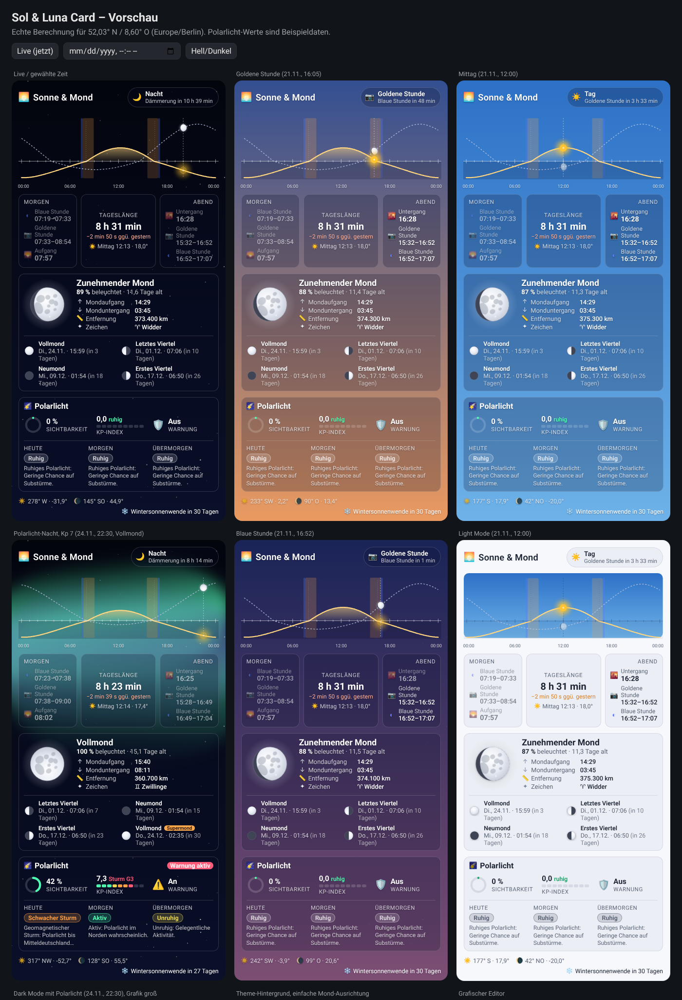
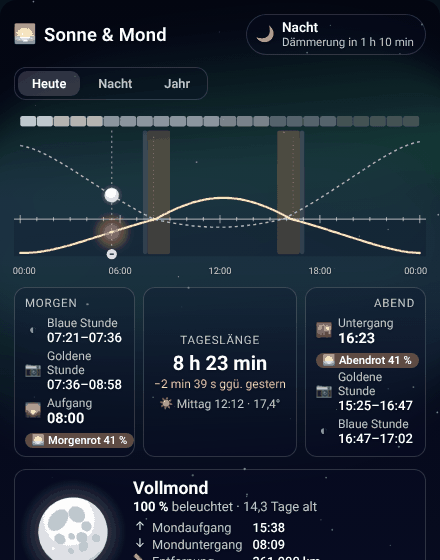

# 🌗 Sol & Luna Card

**🇬🇧 English** · [🇩🇪 Deutsch](README.de.md)

A Home Assistant card for the **sun, moon and sky**: daily sun and moon paths, a realistic moon phase, golden and blue hour, day length, seasons, clouds, planets, eclipses and **aurora** – with a background that changes along with the real sky.



## Features

**Today**
- **Dynamic sky**: the background follows the sun's elevation; at night with stars, shooting stars and an animated aurora when there is activity.
- **Sky path graph**: sun and moon paths, golden/blue hour bands, an hourly **cloud strip** and the **terrain silhouette**.
- **Time scrubber**: drag across the graph to see sky, sun, moon and all values for that time; “Now ↺” jumps back.
- **Sun times**: blue/golden hour, sunrise and sunset, also **over the real horizon**, day length compared with yesterday.
- **Sunset and sunrise glow chance** from high, mid and low clouds.
- **Moon**: phase rotated as seen in the sky, illumination, age, moonrise/moonset, distance, zodiac sign, next phases with super/micro moon.
- **Aurora**: visibility, Kp index, alert, 3-day forecast and a “sky tonight” indicator, from HA entities or directly from NOAA.

**Night**
- **Sky map** with bright stars, constellations (Big Dipper, Cassiopeia, Orion, Summer Triangle), planets and the moon – slide through the night.
- **Sky tonight**: cloud cover hour by hour.
- **Astro window**: astronomical night and moon-free darkness.
- **Planets** (Mercury to Saturn): when visible, best time, direction, brightness, evening/morning star.
- **Meteor showers**: upcoming showers with peak, rate and whether the moon interferes.
- **Eclipses**: solar and lunar eclipses of the coming years, **calculated for your location** (coverage, times, visibility).

**3D**
- **Sky dome & house**: your house (gable roof, size, orientation, PV modules configurable) under a hemisphere with sun, moon, visible planets and bright stars, a real-time shadow and sun paths for today, summer and winter. Drag to rotate, mouse wheel / pinch to zoom, slider for the time of day.
- **Import your real house**: GLB/glTF with colours, official LoD2 building models (CityJSON) or OBJ (+ MTL).

**Year**
- **Day length through the year** with a marker for today.
- **Sun path diagram** (summer, equinox, winter, today) with terrain profile.
- **Dates & records**: seasons, longest/shortest day, earliest/latest sunrise and sunset.

**General**
- Four backgrounds (sky, light, dark, theme) and a **compact layout** as a small tile
- **7 languages**: English, German, Dutch, French, Swedish, Norwegian, Danish
- **Visual editor** for every option; all calculations run locally in the browser



**[▶ Try the live demo](https://muhkuh666.github.io/Sol-Luna-Card/)**

## Installation

### HACS (custom repository)

1. HACS → ⋮ → **Custom repositories**
2. Add URL `https://github.com/muhkuh666/sol-luna-card`, type **Dashboard**
3. Install “Sol & Luna Card” and clear your browser cache

### Manual

1. Copy `dist/sol-luna-card.js` to `/config/www/`
2. Settings → Dashboards → ⋮ → Resources → add `/local/sol-luna-card.js` as a **JavaScript module**

## Configuration

Minimal:

```yaml
type: custom:sol-luna-card
```

Location and time zone are taken from Home Assistant.

Full example:

```yaml
type: custom:sol-luna-card
title: Sun & Moon
layout: full               # full | compact
default_tab: today         # today | night | year
background: sky            # sky | light | dark | theme
graph_size: normal         # small | normal | large
cloud_source: auto         # auto | internet | weather | off
horizon_source: manual     # off | entity | manual
horizon_profile: "0:3, 90:2.5, 180:6, 270:2"
aurora_source: auto        # auto | entities | internet
language: auto
```

### All options

| Option | Default | Description |
|---|---|---|
| `title`, `icon` | “Sun & Moon”, `mdi:weather-sunset` | Title and icon |
| `layout` | `full` | `full` or `compact` (small tile) |
| `show_tabs`, `default_tab` | `true`, `today` | Show tabs, start tab `today` / `night` / `year` |
| `show_night_tab`, `show_year_tab` | `true` | Show/hide tabs |
| `scrub` | `true` | Time scrubber in the graph |
| `show_header`, `show_status` | `true` | Header, status with countdown |
| `show_graph`, `graph_size`, `graph_sky` | `true`, `normal`, `true` | Graph, size `small`/`normal`/`large`, sky gradient in the graph |
| `show_moon_in_graph`, `show_hour_bands`, `show_rise_lines` | `true` | Moon path, golden/blue hour, sunrise/sunset lines |
| `show_sun_times`, `show_moon`, `show_next_phases` | `true` | Sun times, moon, next phases |
| `show_position`, `show_season` | `true` | Azimuth/elevation, next solstice/equinox |
| `show_clouds`, `cloud_source`, `weather_entity` | `true`, `auto`, – | Clouds: `auto` / `internet` (Open-Meteo) / `weather` (HA weather) / `off` |
| `show_glow`, `cloud_update_minutes` | `true`, `30` | Glow chance, refresh interval |
| `horizon_source` | `off` | Real horizon: `off` / `entity` / `manual` |
| `horizon_entity`, `horizon_profile` | – | Entity with a `horizon` attribute, or profile `"0:2, 90:4, 180:1, 270:6"` (azimuth:elevation) |
| `show_sky_map`, `show_sky_tonight`, `show_astro_window` | `true` | Night tab: sky map, clouds, astro window |
| `show_planets`, `show_meteors`, `show_eclipses`, `eclipse_years` | `true`, `3` | Planets, meteor showers, eclipses (years ahead) |
| `show_year_curve`, `show_sun_path`, `show_year_dates` | `true` | Year tab |
| `show_3d_tab`, `show_house`, `show_pv`, `auto_rotate_3d` | `true`, `true`, `true`, `false` | 3D tab |
| `house_source`, `house_model` | `generic`, – | `generic` = house from the sizes below, `file` = **imported model** (LoD2/CityJSON, OBJ, JSON – see below), `entity` = faces from an entity attribute (`building_entity`) |
| `model_rotation`, `model_scale`, `model_up` | `0`, `1`, `auto` | Alignment of imported models |
| `pv_flat_roofs` | `false` | Also draw PV modules on flat roofs (real model) |
| `roof_azimuth`, `roof_pitch` | `180`, `35` | Direction the main roof faces (°), roof pitch (°) |
| `house_width`, `house_length`, `wall_height` | `10`, `12`, `6` | House size in metres (width across the ridge) |
| `wall_color`, `roof_color`, `pv_color` | – | House colours |
| `show_aurora`, `aurora_effect`, `aurora_source` | `true`, `true`, `auto` | Aurora (see below) |
| `background` | `sky` | `sky`, `light`, `dark`, `theme` |
| `moon_orientation` | `sky` | `sky` = rotated as in the sky, `simple` = left/right |
| `stars`, `animations` | `true` | Stars, animations |
| `language` | `auto` | `auto`, `en`, `de`, `nl`, `fr`, `sv`, `nb`, `da` |
| `time_format`, `refresh_period` | `auto`, `60` | 12/24 h, refresh in seconds |
| `*_color` | – | `sun_color`, `moon_color`, `golden_color`, `blue_color`, `curve_color`, `moon_curve_color`, `aurora_color` |
| `latitude`, `longitude`, `time_zone` | from HA | Override the location |

### Import your own 3D house model

Set `house_source: file` and point `house_model` to a file in `/config/www` (served as `/local/…`):

```yaml
house_source: file
house_model: /local/house.glb    # GLB/glTF, CityJSON (LoD2) or OBJ
model_rotation: 0                # degrees clockwise, to align north (mainly OBJ)
model_scale: 1                   # 1 = metres, 0.01 = centimetres
model_up: auto                   # OBJ only: auto | y (Blender default) | z (SketchUp/CAD)
model_zoom: 1                    # start zoom of the 3D view
pv_flat_roofs: false             # also draw PV on flat roofs
```

**LoD2 / CityJSON (official building model)** – German surveying offices provide LoD2 building models for free. Roof, wall and ground surfaces are labelled, coordinates are real (UTM or WGS84). The card picks the building at your Home Assistant location (including building parts such as garages) and places PV modules on roof surfaces facing `roof_azimuth`. CityJSON documents and CityJSONSeq (one feature per line) are supported. In North Rhine-Westphalia you can download your building as CityJSON via the OGC API of Geobasis NRW, for example in the browser:

```
https://ogc-api.nrw.de/3dg/v1/collections/building/items?f=cityjson&bbox=<lon-0.0006>,<lat-0.0004>,<lon+0.0006>,<lat+0.0004>
```

Save the result as `/config/www/house.json`. CityGML files can be converted to CityJSON with [citygml-tools](https://github.com/citygml4j/citygml-tools).

**GLB / glTF (recommended for your own model)** – exported from Blender, SketchUp, SweetHome3D, three.js etc. Colours of all parts are taken from the materials, flat parts at ground level (lawn, paths) are drawn as ground cover. glTF must have embedded buffers (or use GLB). Y up, north = −Z.

**OBJ (your own model)** – export from Blender, SketchUp, SweetHome3D etc. Parts or materials whose name contains `roof`/`Dach` become roof, `PV`/`solar`/`panel`/`Modul` become PV modules; everything else is classified by its slope. If the `.mtl` file named in the OBJ (`mtllib`) lies in the same folder, its colours (`Kd`) are used. Units should be metres (otherwise use `model_scale`), and the model should be centred roughly on the house.

**Simple JSON** – a list of faces `[{ "t": "r"|"w"|"pv", "p": [[x, y, z], …] }, …]` in metres (x = east, y = north, z = up).

### Clouds & sunset glow

By default the card loads cloud cover in three layers from [Open-Meteo](https://open-meteo.com). The **glow chance** is highest with mid/high clouds (roughly 30–70 %) and few low clouds. Alternatively, a Home Assistant weather entity (`weather_entity`) can be used; it only provides total cloud cover.

### Real horizon

Enter the terrain profile manually (`horizon_source: manual`, e.g. `"0:3, 90:2.5, 180:6, 270:2"` as azimuth:elevation in degrees) or take it from an entity with a `horizon` attribute (`horizon_source: entity`). You can read your profile, for example, from the free [PVGIS](https://re.jrc.ec.europa.eu/pvg_tools/) tool (“Horizon profile”).

### Aurora data

`aurora_source` sets where the data comes from:

| Value | Behaviour |
|---|---|
| `auto` (default) | Use aurora entities if found, otherwise load from the internet |
| `entities` | Home Assistant entities only |
| `internet` | Always load directly from NOAA SWPC |

**Internet (NOAA SWPC)** – the card loads in the browser:

- [`noaa-planetary-k-index-forecast.json`](https://services.swpc.noaa.gov/products/noaa-planetary-k-index-forecast.json) – current Kp index and 3-day Kp forecast (old and new NOAA formats are supported)
- [`ovation_aurora_latest.json`](https://services.swpc.noaa.gov/json/ovation_aurora_latest.json) – OVATION model, giving the aurora probability at your location (~0.9 MB, can be turned off with `aurora_ovation: false`)

Activity levels follow the NOAA Aurora Dashboard: Kp 3 quiet, Kp 5 moderate, Kp 7 active, Kp 9 very active, plus the NOAA G scale (G1–G5). The daily forecast uses the highest expected Kp of each day. Whether aurora is possible at your location is estimated with a rule of thumb for Europe (needed Kp ≈ (66 − latitude) / 2, e.g. Kp 7 at 52° N). The alert turns on when visibility reaches `aurora_threshold` (default 50 %) or the current Kp reaches that value. Data is refreshed every `aurora_update_minutes` (default 15) and shared by all cards on the dashboard.

```yaml
aurora_source: internet
aurora_ovation: true
aurora_threshold: 50
aurora_update_minutes: 15
```

### Aurora entities

If nothing is set, the card looks for entities containing “aurora” (visibility in %, alert as `binary_sensor`, forecasts for today/tomorrow/day after) and a Kp index sensor (“k_index” / “kp_index”). If something isn't detected, enter the entities in the editor under **Aurora**:

```yaml
aurora_visibility_entity: sensor.aurora_visibility_visibility
aurora_alert_entity: binary_sensor.aurora_visibility_visibility_alert
aurora_kp_entity: sensor.planetary_k_index
aurora_activity_entity: sensor.aurora_activity_level
aurora_today_entity: sensor.aurora_today
aurora_today_text_entity: sensor.aurora_forecast_today
aurora_tomorrow_entity: sensor.aurora_tomorrow
aurora_tomorrow_text_entity: sensor.aurora_forecast_tomorrow
aurora_day_after_entity: sensor.aurora_day_after
aurora_day_after_text_entity: sensor.aurora_forecast_day_after
```

Clicking an aurora value opens the entity's details.

## Accuracy

Sun and moon are calculated with Meeus' algorithms, the planets with JPL orbital elements. Sun times and moon phases are within a few minutes of published values. Example: solar eclipse on 12 Aug 2026 in Berlin – calculated maximum 20:10, 84.4 % coverage (published: 20:08, 84.4 %).

## Development

The source code lives in `src/`. `python3 build.py` builds `dist/sol-luna-card.js` from it.

## Support

If you like the card: [☕ Buy Me a Coffee](https://buymeacoffee.com/muhkuh666)

## License

MIT © muhkuh666
